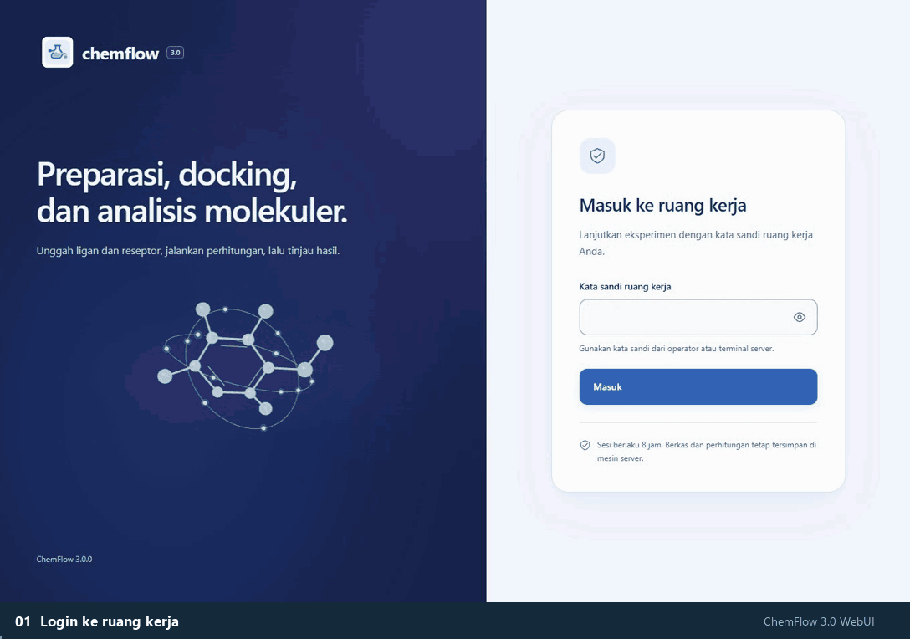

<p align="center">
  
</p>

<h1 align="center">chemflow</h1>

<p align="center">
  Otomasi skrining virtual senyawa obat: dari dua file Excel hingga preparasi struktur, ADMET, docking AutoDock Vina, validasi RMSD, similaritas interaksi, dan grafik siap publikasi.
</p>

<p align="center">
  <a href="https://www.python.org/downloads/"></a>
  <a href="LICENSE"></a>
  <a href="pyproject.toml"></a>
  
</p>

## Ringkasan

chemflow dapat dijalankan lewat WebUI, baris perintah, atau library Python. Masukannya daftar senyawa uji dan daftar protein target dalam format Excel. Alurnya:

1. Menyiapkan struktur 3D ligan (RDKit dan Open Babel) dan membersihkan reseptor (hidrogen polar dan muatan Kollman).
2. Menghitung sifat fisikokimia (Lipinski Rule of Five) dan memprediksi ADMET lewat ADMETLab 3.0 atau dari file CSV/Excel.
3. Menjalankan docking AutoDock Vina untuk banyak reseptor, situs ikat, dan replikasi, termasuk redocking ligan native dengan validasi RMSD.
4. Menggabungkan kompleks protein-ligan, mengekspor interaksi dari BIOVIA Discovery Studio (opsional, Windows), dan menyusun laporan Excel serta grafik 300 dpi.

| | |
| :--- | :--- |
| Antarmuka | WebUI (`python -m chemflow web`), CLI (`chemflow`), library Python |
| Lingkungan | Python 3.10+; Node.js 22 hanya untuk membangun ulang frontend |
| Komponen | RDKit, Open Babel, AutoDock Vina, ADMETLab 3.0 |
| Materi | [Slide](chemflow.pptx) dan [dokumen PDF](chemflow.pdf) |
| Preprint | [PDF](paper/chemflow_preprint.pdf) (bahasa Inggris); [cara mengutip](#cara-mengutip) |
| Lisensi dan penulis | [MIT](LICENSE); Arif Maulana Azis ([@Arifmaulanaazis](https://github.com/Arifmaulanaazis)) |

Dokumentasi teknis per tahap ada di [docs/](docs/README.md). Riwayat versi ada di [CHANGELOG](CHANGELOG.md).

<p align="center">
  
</p>

<p align="center">
  <a href="docs/assets/webui-preview-poster.png">Poster</a> ·
  <a href="docs/assets/webui-desktop.png">Desktop</a> ·
  <a href="docs/assets/webui-mobile.png">Mobile</a> ·
  <a href="docs/assets/webui-molecule.png">Viewer 3D</a> ·
  <a href="docs/assets/webui-wizard.png">Wizard</a>
</p>

<div align="center">
  <a href="https://www.youtube.com/watch?v=QM-KQ9XpmWk" target="_blank" rel="noopener noreferrer">
    
  </a>
  <p><a href="https://www.youtube.com/watch?v=QM-KQ9XpmWk" target="_blank" rel="noopener noreferrer">Video tutorial di YouTube</a></p>
</div>

## Daftar isi

1. [Prasyarat](#1-prasyarat)
2. [Instalasi](#2-instalasi)
3. [Uji coba pertama](#3-uji-coba-pertama)
4. [Menyiapkan data](#4-menyiapkan-data)
5. [Menjalankan pipeline](#5-menjalankan-pipeline)
6. [ADMET](#6-admet)
7. [Membaca hasil](#7-membaca-hasil)
8. [Similaritas interaksi](#8-similaritas-interaksi)
9. [Analisis GC-MS](#9-analisis-gc-ms)
10. [WebUI](#10-webui)
11. [Pemecahan masalah](#11-pemecahan-masalah)
12. [Referensi CLI dan library](#12-referensi-cli-dan-library)

---

## 1. Prasyarat

| Kebutuhan | Kegunaan | Wajib |
| :--- | :--- | :---: |
| Koneksi internet | Unduh PDB (RCSB), SMILES (PubChem), AutoDock Vina (GitHub), dan akses ADMETLab 3.0 | Ya |
| Python 3.10+ | Menjalankan chemflow | Ya |
| Open Babel | Konversi ke `.pdbqt`; satu-satunya aplikasi yang dipasang manual | Ya |
| Aplikasi spreadsheet | Mengisi daftar ligan dan reseptor | Ya |
| BIOVIA Discovery Studio | Ekspor interaksi dan overlay RMSD (Windows; edisi Visualizer gratis cukup) | Tidak |

AutoDock Vina tidak perlu dipasang; biner yang sesuai dengan sistem operasi diunduh otomatis.

## 2. Instalasi

Contoh di bawah memakai Windows. Di macOS dan Linux urutannya sama.

**Python.** Pasang Python 3.10+ dari [python.org](https://www.python.org/downloads/) dengan opsi *Add python.exe to PATH*, lalu periksa dengan `python --version`.

**chemflow.**

```bash
git clone https://github.com/Arifmaulanaazis/chemflow.git
cd chemflow
pip install -r requirements.txt
pip install -e .            # tambahkan ".[web]" untuk WebUI
```

**Open Babel.** Pilih salah satu:

- Miniconda (disarankan):
  ```bash
  conda create -n chemflow_tools -c conda-forge openbabel -y
  conda run -n chemflow_tools where obabel
  ```
  Berikan path `obabel.exe` yang tampil lewat `--openbabel-path` pada run pertama.
- Installer resmi dari [openbabel.org](https://openbabel.org); uji dengan `obabel -V`.

chemflow mencari `obabel` secara berurutan: `--openbabel-path`, preferensi tersimpan, `PATH`, lokasi instalasi umum, lingkungan Conda, lalu paket Python OpenBabel. Lokasi yang ditemukan disimpan di `%LOCALAPPDATA%/chemflow/openbabel.json` (Windows) atau `~/.config/chemflow/openbabel.json` (Linux/macOS).

**Pemeriksaan sistem.**

```bash
python -m chemflow init --output contoh/
```

Perintah ini membuat template Excel dan memeriksa library Python, Open Babel, Vina, dan koneksi layanan online.

## 3. Uji coba pertama

```bash
python -m chemflow run --ligands contoh/ligan_contoh_tidy.xlsx --receptors contoh/reseptor_contoh.xlsx --output hasil_pertama/ --openbabel-path "C:/path/ke/obabel.exe"
```

- Setelah tersimpan, `--openbabel-path` tidak perlu diulang.
- Jika baris reseptor belum punya koordinat gridbox, chemflow menampilkan ligan native pada PDB tersebut dan meminta satu dipilih sebagai pusat docking. Tambahkan `--no-interactive-gridbox` untuk menonaktifkan prompt; koordinat harus sudah terisi.

---

## 4. Menyiapkan data

### 4.1 Excel Senyawa (Ligan)

Tersedia dua format tabel yang dikenali secara otomatis:

#### A. Format *Tidy* (Direkomendasikan)
| Kolom | Wajib? | Keterangan |
| :--- | :---: | :--- |
| `name` | **Ya** | Nama senyawa. Nama folder dan file akan diturunkan secara aman dari kolom ini. |
| `smiles` | Tidak | Struktur SMILES senyawa. Jika dikosongkan, **chemflow** akan mencarinya otomatis di PubChem berdasarkan `name`. |
| `group` | Tidak | Label kelompok/sumber senyawa (mis. `Obat_Sintetis`, `Senyawa_Alami`). Analisis PCA dan HCA memerlukan minimal 2 kelompok berbeda. |

Contoh format *Tidy*:

| name | smiles | group |
| :--- | :--- | :--- |
| Aspirin | `CC(=O)OC1=CC=CC=C1C(=O)O` | Obat_Sintetis |
| Kuersetin | | Senyawa_Alami |

#### B. Format *Wide* (Alternatif Multi-Kolom)
Digunakan bila tabel tidak memiliki kolom `smiles`. Setiap nama kolom dianggap sebagai nama kelompok (`group`), dan setiap sel di bawahnya berisi nama senyawa yang akan dicari otomatis di PubChem:

| Tanaman_X | Tanaman_Y |
| :--- | :--- |
| Quercetin | Curcumin |
| Kaempferol | Demethoxycurcumin |

> **Tip:** Bila suatu nama senyawa tidak ditemukan di PubChem, **chemflow** akan menawarkan input SMILES manual atau melewati senyawa tersebut. Gunakan `--no-pubchem-interactive-fallback` jika ingin langsung melewati senyawa yang gagal tanpa prompt.

<details>
<summary><strong>Aturan Penamaan File Otomatis dari Nama Senyawa (Klik untuk detail)</strong></summary>

Nama kimia sering kali memuat karakter yang tidak diizinkan pada sistem berkas Windows. Oleh karena itu, **chemflow** secara otomatis membuat nama berkas yang aman dan unik:
- Karakter terlarang (`< > : " / \ | ? *`), spasi, dan tanda kurung diubah menjadi garis bawah (`_`). Titik atau garis di ujung nama dihapus.
- Huruf beraksen dinormalisasi ke huruf dasar (`Café` $\rightarrow$ `Cafe`) dan huruf Yunani ditulis namanya (`α-Tocopherol` $\rightarrow$ `alpha-Tocopherol`).
- Nama cadangan perangkat Windows (`CON`, `NUL`, `AUX`, `COM1`–`COM9`, `LPT1`–`LPT9`) diberi akhiran garis bawah.
- Aksara non-Latin (mis. karakter Mandarin) diubah menjadi `unnamed_<hash>`.
- Nama yang menjadi kembar setelah dirapikan (termasuk perbedaan huruf besar/kecil seperti `Aspirin` dan `ASPIRIN`) diberi akhiran `_2`, `_3`, dst.
- Panjang nama dibatasi maksimal 60 karakter (atau menyesuaikan kedalaman direktori output) agar tidak melebihi batas 260 karakter Windows.
- Pemetaan lengkap antara nama asli dan `nama_file` dapat dilihat pada sheet **`Ringkasan Ligan`** di `hasil_chemflow.xlsx`.
</details>

---

### 4.2 Excel Protein (Reseptor)

| Kolom | Wajib? | Keterangan |
| :--- | :---: | :--- |
| `pdb_code` | **Ya** | Kode 4 karakter struktur protein dari [RCSB PDB](https://www.rcsb.org) (contoh: `6LU7`, `6X3Z`). |
| `center_x`, `center_y`, `center_z` | Tidak | Koordinat titik pusat kotak docking (*gridbox*) dalam satuan Ångström ($\text{\AA}$). |
| `size_x`, `size_y`, `size_z` | Tidak | Dimensi ukuran *gridbox* ($\text{\AA}$). Jika dikosongkan, dihitung otomatis dari ukuran ligan native. |

- **Penentuan Ukuran Gridbox Otomatis**: Dihitung sebagai kubus dari rentang terpanjang ligan native ditambah *padding* $8\text{ \AA}$ (dibulatkan ke atas, minimum $18\text{ \AA}$ dan maksimum $30\text{ \AA}$). Nilai *padding* dapat diatur dengan `--box-padding`, dan ukuran cadangan bila struktur tidak memiliki ligan native diatur lewat `--default-box-size` (bawaan `20`).
- **Multi-Situs & Multi-Reseptor**: Kode PDB yang sama boleh ditulis pada beberapa baris dengan koordinat pusat berbeda untuk *multi-site docking*.

#### Menyusun Excel Reseptor Secara Interaktif (`receptor-config`)
Jika Anda belum mengetahui koordinat dan ukuran *gridbox*, jalankan asisten interaktif berikut sebelum memulai pipeline:

```bash
python -m chemflow receptor-config
```

Asisten ini akan memandu Anda:
1. Memasukkan satu atau beberapa kode PDB (misal: `3PTB 1HVR`).
2. Mengunduh struktur dari RCSB dan menampilkan tabel seluruh ligan native yang terdeteksi beserta saran titik pusat dan ukuran *gridbox*-nya.
3. Memilih nomor ligan (bisa lebih dari satu nomor untuk *multi-site*, `m` untuk input koordinat manual, atau `s` untuk melewati).
4. Menyimpan hasilnya langsung menjadi file Excel (bawaan: `reseptor.xlsx`) yang siap digunakan pada `--receptors`.

<details>
<summary><strong>Contoh Sesi Interaktif <code>chemflow receptor-config</code> (Klik untuk melihat)</strong></summary>

```text
Kode PDB (pisahkan dengan spasi atau koma, contoh 6LU7 3PTB): 3PTB

[1/1] 3PTB: mengunduh struktur dari RCSB
Ligan native pada 3PTB:
  No  Chain   Residu   Nomor   Atom    Pusat X    Pusat Y    Pusat Z   Kotak
   1      A      BEN       1      9     -1.759     14.461     16.916      18
   2      A       CA     480      1    -10.300      4.358     36.895      18
Pilih nomor ligan (beberapa nomor dipisah spasi), m untuk koordinat manual, s untuk melewati: 1

Ligan BEN_A1: pusat (-1.759, 14.461, 16.916), panjang 4.5 Angstrom.
Ukuran kotak x y z dalam Angstrom, Enter untuk 18 (satu angka untuk kubus):

Nama file keluaran [reseptor.xlsx]:
```
</details>

---

## 5. Menjalankan pipeline

```bash
python -m chemflow run --ligands ligan.xlsx --receptors reseptor.xlsx --output hasil/
```

Opsi yang sering dipakai:

| Opsi | Fungsi |
| :--- | :--- |
| `--n-replicates 3` | Ulangi tiap pasangan docking dengan seed berbeda; hitung rata-rata dan simpangan baku ΔG |
| `--exhaustiveness 16` | Ketelitian pencarian Vina (bawaan 8) |
| `--merge-mode all` | Simpan semua pose sebagai kompleks terpisah (bawaan `best`) |
| `--no-native` | Lewati ekstraksi dan redocking ligan native |
| `--no-run-rmsd-validation` | Matikan validasi RMSD |
| `--rmsd-backend rdkit` | Hitung RMSD dengan RDKit saja, tanpa BIOVIA (bawaan `auto`) |
| `--no-rmsd-overlay` | Jangan ekspor gambar overlay RMSD |
| `--no-similarity` | Lewati ekspor interaksi BIOVIA |
| `--admet-file file.csv` | Pakai hasil ADMETLab 3.0 yang diunduh manual |
| `--no-admet` | Lewati ADMET |
| `--gcms data-gcms/` | Jalankan analisis GC-MS setelah pipeline |
| `--dpi 600`, `--figure-formats png svg pdf` | Resolusi dan format grafik |
| `--plot-max-rows 30` | Batas baris per gambar sebelum dipotong otomatis (`0` = tanpa batas) |

Seluruh opsi: `python -m chemflow run --help`.

### 5.1 Melanjutkan run yang terhenti

Setiap tahap yang selesai dicatat sebagai checkpoint di `hasil/_state/`. Jika proses terhenti, lanjutkan dengan:

```bash
python -m chemflow resume --output hasil/
```

Konfigurasi dibaca kembali dari `_state/`, dan tahap yang sudah selesai tidak diulang. Pada folder yang sudah selesai, `resume` hanya menyusun ulang laporan dan grafik.

### 5.2 Ligan native dan validasi RMSD

Ligan kokristal yang paling dekat dengan pusat gridbox (maksimal 8 Å) diekstrak, di-*redock* dengan parameter yang sama seperti ligan uji, lalu dimasukkan sebagai grup **Native** pada semua analisis.

RMSD dihitung antara seluruh pose redocking dan koordinat kristal asli tanpa superposisi. Pose dengan RMSD < 2,0 Å digolongkan baik (2,0 sampai < 3,0 Å dapat diterima). Di Windows, backend `auto` memakai BIOVIA dan menghasilkan gambar overlay (sian: native kristal, oranye: pose docking); jika BIOVIA tidak tersedia atau gagal, perhitungan memakai RDKit dan alasannya dicatat. Workbook memisahkan RMSD minimum semua pose dari RMSD pose berafinitas terbaik. Rincian ada di [docs/rmsd-validation.md](docs/rmsd-validation.md).

### 5.3 Validasi RMSD mandiri

Untuk memvalidasi redocking tanpa ligan uji, ADMET, atau docking skrining:

```bash
python -m chemflow run --rmsd-only --receptors reseptor.xlsx --output validasi/ --no-similarity
```

| Opsi | Keterangan |
| :--- | :--- |
| `--rmsd-merge-mode {best,all}` | Pose yang digabung menjadi kompleks di `rmsd/complexes/` (bawaan `best`, RMSD terkecil) |
| `--rmsd-interaction-mode {best,all}` | Kompleks yang diekspor interaksinya ke BIOVIA (bawaan `best`) |
| `--similarity` / `--no-similarity` | Ekspor interaksi BIOVIA untuk kompleks RMSD |

Hasil ada di `rmsd/hasil_rmsd.xlsx` (sheet `Validasi RMSD` dan `Hasil Docking`). Interaksinya dapat diekspor terpisah dengan `python -m chemflow interactions --output validasi/ --rmsd`.

## 6. ADMET

Secara bawaan SMILES unik dikirim ke ADMETLab 3.0 dengan pengulangan otomatis saat server sibuk (HTTP 429). Jika server tidak tersedia, unduh hasilnya secara manual: masukkan SMILES dengan urutan yang sama seperti Excel ligan di menu *Screening* ADMETLab 3.0, simpan sebagai `.csv` atau `.xlsx`, lalu:

```bash
python -m chemflow run --ligands ligan.xlsx --receptors reseptor.xlsx --admet-file hasil_admetlab.csv
```

Baris ke-N pada file dipetakan ke ligan ke-N (atau SMILES unik ke-N bila ada senyawa kembar antargrup). Jika file memuat kolom `raw_smiles` atau `smiles`, kecocokan struktur diperiksa otomatis.

## 7. Membaca hasil

```text
hasil/
├── hasil_chemflow.xlsx       # laporan utama (multi-sheet)
├── chemflow.log              # log lengkap
├── ligands/<nama>/           # gambar 2D, struktur 3D, .pdbqt (termasuk NATIVE_*)
├── receptors/<kunci>/        # reseptor siap docking dan reseptor bersih
├── docking/<kunci>/<ligan>/  # pose Vina (.pdbqt) dan log per replikat
├── complexes/<kunci>/        # kompleks protein-ligan (.pdb)
├── analytics/                # grafik
├── interaksi/<kunci>/        # diagram interaksi 2D dan tabel Non-bond (BIOVIA)
├── rmsd/                     # laporan dan kompleks validasi RMSD
├── gcms/                     # hasil GC-MS (bila diaktifkan)
└── _state/                   # checkpoint untuk `resume`
```

Sheet pada `hasil_chemflow.xlsx`:

| Sheet | Isi |
| :--- | :--- |
| Ringkasan Ligan | Senyawa uji dan native, SMILES, grup, status preparasi, `nama_file` |
| Hasil Docking | ΔG (kcal/mol) tiap replikat; makin negatif makin kuat |
| Fisikokimia (Lipinski) | MW, LogP, HBD, HBA, jumlah pelanggaran, status Ro5 |
| ADMET | Parameter ADMETLab 3.0 per kategori; sel hijau (baik), kuning (sedang), merah (buruk) |
| Legenda ADMET | Kategori, satuan, ambang batas, dan referensi tiap parameter |
| Validasi RMSD | RMSD redocking native (Å) dan status validasi |
| Statistik Replikasi | Rata-rata, simpangan baku, ΔG terbaik, `delta_vs_native` |
| Ringkasan per Grup | Rata-rata fisikokimia, persentase lolos Ro5, skor ADMET per grup |
| Docking per Grup | ΔG rata-rata dan terbaik per grup terhadap native |

Grafik di `analytics/`:

| Berkas | Isi |
| :--- | :--- |
| `bar_affinity.png` | Peringkat afinitas ligan uji dan native |
| `radar_combined.png`, `radar_admet_<kategori>.png` | Radar profil gabungan dan per kategori ADMET |
| `admet_klasifikasi_<kategori>.png` | Distribusi Baik/Sedang/Buruk per parameter |
| `heatmap_afinitas.png`, `heatmap_fisikokimia*.png` | Peta panas afinitas dan Lipinski (termasuk versi terklaster) |
| `pca_2d.png`, `pca_3d.png` | PCA bergaya jurnal dengan elips kepercayaan 95% |
| `hca_dendrogram.png` | Dendrogram Ward (jarak Euclidean) |
| `grup_*.png` | Perbandingan antarkelompok |

## 8. Similaritas interaksi

Kesamaan residu kontak dan tipe interaksi antara ligan uji dan native dihitung dengan metode Pratama et al. (2021) dari tabel interaksi BIOVIA Discovery Studio.

- **Otomatis (Windows dengan BIOVIA):** `chemflow run` mengekspor diagram 2D dan tabel Non-bond tiap kompleks ke `interaksi/`, lalu menghitung similaritas. Selama otomasi GUI, input mouse dan keyboard dikunci sementara; tekan `Esc` tiga kali berturut-turut untuk membatalkan.
- **Ekspor saja:** `python -m chemflow interactions --output hasil/`
- **Perhitungan saja** (tabel interaksi sudah ada): `python -m chemflow similarity --output hasil/`

Hasilnya `similaritas_interaksi.xlsx`, `similaritas_bar.png`, `similaritas_vs_deltag.png`, dan peta jejak kontak per reseptor. Lihat [docs/biovia-interactions.md](docs/biovia-interactions.md) dan [docs/similarity-analysis.md](docs/similarity-analysis.md).

## 9. Analisis GC-MS

Modul kemometrik untuk membandingkan kromatogram atau tabel puncak GC-MS, misalnya autentikasi minyak atsiri asli dan tiruan. Dapat dijalankan mandiri atau setelah pipeline docking:

```bash
python -m chemflow gcms --data data-gcms/ --output hasil/
python -m chemflow run --ligands ligan.xlsx --receptors reseptor.xlsx --output hasil/ --gcms data-gcms/
```

Format masukan: ekspor Shimadzu GCMSsolution (`.xls`, `.xlsx`, `.txt`), CSV/TSV, ANDI-MS (`.cdf`), `.mzML`, `.mzXML`. Keluaran di `hasil/gcms/`: `analisis_gcms.xlsx` (puncak, fitur selaras, uji statistik dengan koreksi FDR, VIP PLS-DA, PCA, kemiripan kosinus, alergen), `plots/`, dan `ligan_gcms.xlsx` yang dapat dipakai langsung sebagai `--ligands`. Lihat [docs/gcms-analysis.md](docs/gcms-analysis.md).

## 10. WebUI

```bash
python -m pip install -e ".[web]"
cd frontend && npm ci && npm run build && cd ..
python -m chemflow web
```

Buka `http://127.0.0.1:8000` dan masuk dengan kata sandi acak yang dicetak di terminal, atau atur `CHEMFLOW_WEB_PASSWORD` (minimal 12 karakter). Server hanya mendengarkan localhost; untuk jaringan lokal gunakan `--host 0.0.0.0 --allowed-host <alamat>`, dan untuk tunnel HTTPS gunakan domain eksplisit dengan `--secure-cookie`.

WebUI menyediakan wizard empat langkah, antrean job dengan checkpoint dan log langsung, formulir untuk konfirmasi SMILES dan pemilihan ligan native, viewer 3D (NGL) untuk struktur, pose, dan gridbox, pratinjau tabel dan grafik hasil, serta pembaruan otomatis dari rilis stabil GitHub. Panduan lengkap: [docs/webui.md](docs/webui.md) dan [docs/webui-architecture.md](docs/webui-architecture.md).

## 11. Pemecahan masalah

| Gejala | Penyebab dan solusi |
| :--- | :--- |
| `Executable 'obabel' tidak ditemukan` | Pasang Open Babel (bagian 2) atau berikan lokasinya dengan `--openbabel-path` |
| SMILES tidak ditemukan di PubChem | Gunakan nama IUPAC/internasional dalam bahasa Inggris, atau isi kolom `smiles` |
| ADMETLab 3.0 membalas `HTTP 429` atau lambat | Server membatasi permintaan; chemflow mengulang otomatis. Jika tetap gagal, pakai `--admet-file` atau `--no-admet` |
| `File ADMET ... berisi N baris, sedangkan input memuat M ligan` | Jumlah baris file ADMET harus sama dengan jumlah ligan (atau SMILES unik) |
| `PCA dilewati: ... minimal 2 kelompok` | Isi minimal dua grup berbeda pada kolom `group`, atau biarkan ligan native aktif |
| Proses terhenti (terminal tertutup, `Ctrl+C`, komputer mati) | `python -m chemflow resume --output hasil/` |
| Proses menunggu input | chemflow menunggu pilihan ligan native atau SMILES. Gunakan `--no-interactive-gridbox` dan `--no-pubchem-interactive-fallback` untuk mode tanpa prompt |
| `Gagal mengunduh PDB ...` | Periksa kode PDB di [rcsb.org](https://www.rcsb.org) |
| `Similaritas interaksi dilewati: BIOVIA tidak terdeteksi` | Bukan galat. Komputer bukan Windows atau BIOVIA belum terpasang; pipeline tetap selesai |
| `Fokus jendela BIOVIA hilang` atau `Dibatalkan pengguna (Esc 3x)` | Jalankan ulang `python -m chemflow interactions --output hasil/`; kompleks yang sudah selesai dilewati |

Traceback lengkap ada di `chemflow.log` pada folder keluaran.

## 12. Referensi CLI dan library

<details>
<summary>Argumen <code>chemflow run</code></summary>

| Kategori | Argumen |
| :--- | :--- |
| Input dan output | `--ligands`, `--receptors`, `--output` |
| Kolom Excel | `--ligand-name-col`, `--ligand-smiles-col`, `--ligand-group-col`, `--receptor-pdb-col` |
| Gridbox | `--default-box-size`, `--box-padding`, `--no-interactive-gridbox` |
| Ligan | `--force-field {MMFF94,UFF}`, `--minimize-max-iters`, `--no-2d-image` |
| Reseptor | `--keep-waters`, `--keep-hetero-ligands`, `--no-keep-metals`, `--kollman-fallback {zero,gasteiger}` |
| Docking | `--vina-version`, `--vina-executable`, `--exhaustiveness`, `--num-modes`, `--energy-range`, `--seed`, `--n-replicates` |
| Merge | `--merge-mode {best,all}` |
| Native dan RMSD | `--no-native`, `--run-rmsd-validation`, `--rmsd-only`, `--rmsd-backend`, `--no-rmsd-overlay`, `--rmsd-merge-mode`, `--rmsd-interaction-mode`, `--rmsd-threshold-good`, `--rmsd-threshold-acceptable` |
| BIOVIA dan similaritas | `--similarity`, `--no-similarity`, `--biovia-exe`, `--biovia-timeout`, `--no-lock-input` |
| Open Babel | `--openbabel-path` |
| ADMET dan PubChem | `--no-admet`, `--admet-file`, `--admet-batch-size`, `--admet-ssl-verify`, `--no-pubchem-fetch`, `--no-pubchem-interactive-fallback` |
| Grafik | `--no-charts`, `--no-pca`, `--no-hca`, `--no-heatmap`, `--dpi`, `--figure-formats`, `--plot-max-rows`, `--plot-max-cols` |
| GC-MS | `--gcms`, `--gcms-groups`, `--gcms-library` |
| Log | `--verbose`, `--log-level`, `--no-progress` |
</details>

Subperintah:

| Perintah | Fungsi |
| :--- | :--- |
| `web` | Menjalankan WebUI (`--host`, `--port`, `--workspace`, `--allowed-host`, `--trusted-proxy`, `--secure-cookie`) |
| `init` | Membuat template Excel dan memeriksa kesiapan sistem |
| `run` | Pipeline utama, atau validasi `--rmsd-only` |
| `resume` | Melanjutkan dari checkpoint |
| `receptor-config` | Menyusun Excel reseptor dan gridbox secara interaktif |
| `interactions` | Ekspor diagram dan tabel interaksi dari BIOVIA (Windows) |
| `similarity` | Hitung similaritas interaksi terhadap ligan native |
| `gcms` | Analisis GC-MS mandiri |
| `list-vina-versions` | Daftar versi Vina yang kompatibel |
| `citations` | Sitasi perangkat lunak dan pustaka dalam teks atau BibTeX |

Pemakaian sebagai library:

```python
from chemflow import Pipeline, PipelineConfig

config = PipelineConfig(ligand_excel="ligan.xlsx", receptor_excel="reseptor.xlsx", output_dir="hasil")
Pipeline(config).run()
```

Setiap modul juga dapat dipanggil terpisah; contohnya ada di [docs/library-usage.md](docs/library-usage.md).

Pengujian:

```bash
pytest tests/ -v
```

Pengujian berjalan lokal dengan data sintetis, tanpa koneksi internet, Open Babel, maupun Vina.

## Cara mengutip

Jika ChemFlow dipakai dalam penelitian, kutip preprint-nya dan sebutkan versi perangkat lunak yang digunakan (`python -c "import chemflow; print(chemflow.__version__)"`). GitHub juga menyediakan tombol **Cite this repository** di halaman repositori, yang membaca berkas [CITATION.cff](CITATION.cff).

**Teks (APA 7)**

> Azis, A. M. (2026). *ChemFlow: An auditable workflow for docking-based virtual screening with redocking validation and chemometric analysis* (Preprint v1.0) [Preprint]. https://github.com/Arifmaulanaazis/chemflow

**Teks (IEEE)**

> A. M. Azis, "ChemFlow: An auditable workflow for docking-based virtual screening with redocking validation and chemometric analysis," preprint v1.0, Nov. 2026. [Online]. Available: https://github.com/Arifmaulanaazis/chemflow

**BibTeX**

```bibtex
@misc{azis2026chemflow,
  author       = {Azis, Arif Maulana},
  title        = {{ChemFlow}: An Auditable Workflow for Docking-Based Virtual Screening with Redocking Validation and Chemometric Analysis},
  year         = {2026},
  month        = nov,
  note         = {Preprint v1.0, not peer reviewed},
  howpublished = {\url{https://github.com/Arifmaulanaazis/chemflow}}
}

@misc{azis2026chemflowsoftware,
  author       = {Azis, Arif Maulana},
  title        = {{ChemFlow}: {CLI} and {WebUI} for molecular screening},
  year         = {2026},
  note         = {Software, version 3.1.0, MIT License},
  howpublished = {\url{https://github.com/Arifmaulanaazis/chemflow}}
}
```

Dalam dokumen LaTeX, simpan entri di `refs.bib`, muat paket `url` bila kelas dokumen belum memuatnya, lalu kutip dengan `\cite{azis2026chemflow}`. Untuk gaya numerik IEEE, pakai `\bibliographystyle{IEEEtran}` dan `\bibliography{refs}`.

Perintah berikut mencetak sitasi ChemFlow beserta pustaka pendukungnya (Vina, Open Babel, RDKit, ADMETlab, dan lainnya) dalam teks atau BibTeX, dengan versi yang terpasang:

```bash
python -m chemflow citations --format bibtex
```

## Referensi ilmiah

- Lipinski et al. (1997), *Adv. Drug Deliv. Rev.*: Rule of Five.
- Fu et al. (2024), *Nucleic Acids Res.* 52(W1):W422-W431: ADMETLab 3.0.
- Morris et al. (2009), *J. Comput. Chem.*: tipe atom AutoDock4 dan format PDBQT.
- Cornell et al. (1995), *J. Am. Chem. Soc.* 117:5179; Hornak et al. (2006), *Proteins* 65(3):712-725: muatan parsial AMBER.
- Hevener et al. (2009), *J. Chem. Inf. Model.* 49(2):444-460: kriteria RMSD redocking (< 2,0 Å baik; 2,0 sampai < 3,0 Å dapat diterima).
- Pratama, Poerwono, & Siswodihardjo (2021), *Indones. J. Biotechnol.* 26(1):54-60, doi:10.22146/ijbiotech.62194: similaritas interaksi ligan-reseptor.
- Aghoutane et al. (2023), *Micromachines* 14(3):524, doi:10.3390/mi14030524: konvensi PCA dan analisis GC-MS.
- Eilers & Boelens (2005), koreksi baseline; Savitzky & Golay (1964), *Anal. Chem.* 36(8):1627-1639; Dieterle et al. (2006), *Anal. Chem.* 78(13):4281-4290, normalisasi PQN; Benjamini & Hochberg (1995), *J. R. Stat. Soc. B* 57(1):289-300, koreksi FDR.
- Okabe & Ito (2008): palet warna ramah buta warna.

## Lisensi

[MIT](LICENSE). Dikembangkan oleh Arif Maulana Azis ([@Arifmaulanaazis](https://github.com/Arifmaulanaazis)).
