# Validasi RMSD Redocking

Implementasi: `chemflow.docking.rmsd_validation.RedockingValidator`.

## Otomatis: BIOVIA dengan fallback RDKit

Validasi RMSD aktif secara bawaan pada run baru. Backend `auto` mencoba
BIOVIA Discovery Studio pada Windows dengan dependensi otomasi lengkap.
Jika clipboard tidak cocok, otomasi memakai satu berkas script. Jika aplikasi
tidak ada, lisensi/startup gagal, atau kalkulasi tidak menghasilkan nilai yang
valid, perhitungan RDKit yang ada tetap dipakai. Satu kegagalan sesi BIOVIA menonaktifkan percobaan GUI
untuk sisa pose pada run itu, sehingga tidak terjadi timeout berulang.

```bash
chemflow run --ligands ligan.xlsx --receptors reseptor.xlsx --output hasil
chemflow run --ligands ligan.xlsx --receptors reseptor.xlsx --output hasil --rmsd-backend rdkit
chemflow run --ligands ligan.xlsx --receptors reseptor.xlsx --output hasil --no-rmsd-overlay
chemflow run --ligands ligan.xlsx --receptors reseptor.xlsx --output hasil --no-run-rmsd-validation
chemflow resume --output hasil --run-rmsd-validation --rmsd-backend auto
```

Backend RMSD independen dari `--similarity`/`--no-similarity`. Opsi tersebut
tetap mengatur ekspor interaksi dan analisis similaritas. Checkpoint lama
mempertahankan pilihan `run_rmsd_validation` yang tersimpan; gunakan override
pada `resume` untuk mengubahnya.

Setiap pose memiliki direktori
`rmsd/molecules/<reseptor>/<native>_repXX_modeXX/`, berisi:

- `native_crystal.sdf`: koordinat ligan kristal asli, tanpa minimisasi.
- `docked.sdf`: koordinat pose setelah docking.
- `pair.sdf`: kedua molekul sebagai dua record terpisah, siap dibuka sekaligus.
- `atom_mapping.json`: pemetaan lengkap atom berat dan asal koordinat.
- `biovia_rmsd.pl` dan `biovia_result.tsv`, bila BIOVIA dicoba.
- `biovia_overlay_<token>.png`, bila ekspor visualisasi BIOVIA berhasil.

**`ligands/NATIVE_…/*.pdb` adalah hasil preparasi SMILES untuk input docking,
bukan referensi kristal RMSD.** Konformasi ini dibuat dekat titik asal, sehingga
terlihat jauh jika ditampilkan bersama pose docking di koordinat reseptor.
Gunakan `pair.sdf` atau `native_crystal.sdf` untuk perbandingan.

Molekul dipetakan berdasarkan graf kimia penuh dan simetri, termasuk
oksigen ekuivalen pada gugus fosfat/karboksilat. Urutan atom disamakan tanpa
rotasi, translasi, alignment, atau perubahan posisi atom. Pemetaan parsial
dan pemetaan yang tidak mereproduksi `CalcRMS` ditolak untuk jalur BIOVIA.

Otomasi memakai API DiscoveryScript resmi `CalculateHeavyAtomRmsd`.
Script membentuk dua molekul di memori; jalur utama menempelkan script ke
Script Window lewat clipboard, memverifikasi isi editor, lalu menjalankannya.
Jika tidak didukung antarmuka versi yang terpasang, satu berkas script
dijalankan oleh client. Kedua jalur tidak membutuhkan dua dialog Open.
`SaveImage` mengekspor tampilan asli BIOVIA (native sian, docked jingga),
sehingga tidak bergantung pada screenshot desktop yang bisa tertutup jendela
lain. Ekspor gambar gagal tidak membatalkan angka RMSD yang sudah sah.

Sheet `Validasi RMSD` dan `Hasil Docking` mencatat `metode`, `rmsd_backend`,
`rdkit_rmsd_angstrom`, `fallback_reason`, jalur pasangan, laporan, dan gambar.
Metode BIOVIA bernama `BIOVIA_HeavyAtoms`; cadangannya tetap `CalcRMS` atau
`fallback_greedy`. Hasil BIOVIA ditolak bila tidak finite, negatif, berasal
dari eksekusi lama, atau berbeda lebih dari 0,002 Å dari pasangan tanpa alignment.

Ringkasan memilih RMSD minimum; `rmsd_affinity_best_angstrom` melaporkan
RMSD pose berafinitas terbaik secara terpisah. Contoh run lama di `hasil`:
ATP mode 1 = 2,742 Å, sedangkan minimum berada pada mode 2 = 1,738 Å.
Keduanya menjawab pertanyaan evaluasi yang berbeda dan tidak boleh tertukar.

Untuk menguji data hasil yang sudah ada tanpa mengubahnya atau mengulang docking:

```bash
python scripts/verify_rmsd_results.py --source hasil --output output/rmsd-check --backend auto
```

Kriteria RMSD lebih kecil dari 2.0 Angstrom antara pose redocking dan
ligan native kristalografi umum dipakai sebagai kriteria "baik" pada
validasi docking self-docking/redocking. Lihat Hevener et al. 2009,
*J. Chem. Inf. Model.* 49(2):444-460 (PMC2788795). Sebagian studi
memakai ambang lebih longgar (2.0-3.0 A sebagai "acceptable") atau
lebih ketat (1.5 A). Kedua ambang bisa dikonfigurasi via
`rmsd_threshold_good` dan `rmsd_threshold_acceptable`.

```mermaid
flowchart TD
    Start([Mulai: ligan native terpilih + koordinat kristalografi asli]) --> Extract[to_pdb_block: ekstrak blok PDB residu native, ground truth, tanpa modifikasi]
    Extract --> Template[Ambil SMILES templat komponen kimia dari RCSB, simpan di cache]
    Template --> AssignBonds[AssignBondOrdersFromTemplate: orde ikatan ke koordinat kristal]
    AssignBonds --> BondsOk{Templat cocok dengan atom kristal?}
    BondsOk -->|Ya| ToSmiles[MolToSmiles dari molekul bertopologi benar]
    BondsOk -->|Tidak| Fallback0[SMILES dari koordinat saja, dengan peringatan]
    Fallback0 --> ToSmiles
    ToSmiles --> PrepLikeScreening[["Siapkan ligan native persis seperti ligan screening (lihat ligand-preparation.md)"]]
    PrepLikeScreening --> Redock[["Redocking sebagai ligan referensi: run_matrix ke reseptornya sendiri, gridbox dan parameter sama, n_replicates sama dengan ligan uji"]]
    Redock --> RedockOk{Redocking sukses dan menghasilkan pose?}
    RedockOk -->|Tidak| FailRedock[["status = gagal, dicatat, reseptor lain tetap lanjut"]]
    RedockOk -->|Ya| BestPose[Hitung RMSD semua pose semua replikat, pilih RMSD minimum]
    BestPose --> RemoveHs[RemoveHs pada pose dan native: bandingkan heavy-atom saja]
    RemoveHs --> CalcRms[rdMolAlign.CalcRMS: pada posisi asli tanpa superposisi, memperhitungkan simetri, atom-mapping otomatis]
    CalcRms --> CalcRmsOk{Berhasil? Graf molekul cocok}
    CalcRmsOk -->|Tidak| Fallback[["Fallback: pencocokan greedy per elemen dan jarak terdekat, RMSD tetap tanpa superposisi"]]
    CalcRmsOk -->|Ya| Threshold1{RMSD < rmsd_threshold_good?}
    Fallback --> FallbackOk{Kedua metode gagal total?}
    FallbackOk -->|Ya| FailBoth[["status = gagal, rmsd = None, tidak pernah raise ke pipeline utama"]]
    FallbackOk -->|Tidak| Threshold1
    Threshold1 -->|Ya| Good[status = good]
    Threshold1 -->|Tidak| Threshold2{RMSD < rmsd_threshold_acceptable?}
    Threshold2 -->|Ya| Acceptable[status = acceptable]
    Threshold2 -->|Tidak| Poor[status = poor]
    Good --> End([RmsdValidationResult: rmsd, status, metode, catatan])
    Acceptable --> End
    Poor --> End
```



## RMSD pada posisi asli

RMSD dihitung terhadap koordinat kristal pada posisi aslinya, tanpa superposisi
(`rdMolAlign.CalcRMS`, memperhitungkan simetri molekul, sehingga urutan atom setara
tidak mempengaruhi hasil). Pose Vina berada pada kerangka koordinat reseptor yang sama
dengan struktur kristal, jadi pose yang bentuknya benar tetapi bergeser di dalam kantong
ikat tetap terbaca buruk. Perhitungan yang menyelaraskan pose ke kristal lebih dulu
(`GetBestRMS`) hanya mengukur kemiripan bentuk dan menyembunyikan pergeseran itu.

Contoh dari satu run dengan Vina 1.2.7 (exhaustiveness 8) pada pose yang sama:

| Reseptor | Ligan native | Pada posisi asli (`CalcRMS`) | Setelah superposisi (`GetBestRMS`) |
|---|---|---|---|
| 1HSG | MK1 (indinavir) | 10,53 A | 4,05 A |
| 1UWH | BAX (sorafenib) | 0,57 A | 0,42 A |

Kolom `metode` sheet "Validasi RMSD" berisi `CalcRMS`, atau `fallback_greedy` bila graf
molekul pose dan native tidak cocok. Fallback memasangkan atom secara greedy menurut
elemen dan jarak terdekat tanpa memperhatikan topologi, jadi nilainya perkiraan yang
cenderung tidak lebih besar dari RMSD sebenarnya.

Koordinat kristal ligan pada PDB tidak memuat orde ikatan, sehingga SMILES
yang diturunkan langsung dari koordinat menghasilkan molekul jenuh yang salah
secara kimia. Karena itu SMILES ligan native diambil dari templat komponen
kimia RCSB (`chemflow.io.ligand_template`) dan orde ikatannya dipetakan ke
koordinat kristal. Templat disimpan di `_cache/ligand_templates/` sehingga
run berikutnya tidak mengunduh ulang. Jika templat tidak tersedia atau tidak
cocok, digunakan SMILES dari koordinat dan sebuah peringatan dicatat.

Afinitas pose dengan RMSD minimum (mode dan replikat tercatat) dicatat pada kolom `redock_affinity`
sheet "Validasi RMSD" dan dipakai sebagai afinitas referensi pada analisis
similaritas interaksi (selisih ΔG).

## Ligan native sebagai ligan referensi

Redocking dijalankan sebagai bagian docking ligan referensi, bukan di dalam
validasi. Tiap ligan native diperlakukan sebagai ligan referensi (`NativeEntry`,
nama `NATIVE_<label>`):

1. SMILES diturunkan dari templat RCSB, lalu ligan disiapkan seperti ligan uji.
2. Di-dock ke reseptornya sendiri lewat `DockingOrchestrator.run_matrix`, dengan gridbox,
   `exhaustiveness`, `num_modes`, `energy_range`, seed dasar, dan `n_replicates` yang sama
   dengan ligan uji, sehingga ΔG-nya sebanding.
3. Lipinski dan ADMET-nya dihitung (ADMET ikut jalur SMILES unik).
4. Semuanya masuk ke sheet Excel dan seluruh analitik sebagai grup **Native**
   (`--no-native` mematikannya).
5. Validasi RMSD (aktif secara bawaan) membaca semua pose hasil docking native itu dan memilih RMSD minimum
   (`docking/<kunci>/NATIVE_<label>/`).

Native untuk jalur Excel dipilih dari ligan terdekat dengan pusat kotak, paling jauh
`native_match_radius` (default 8 Angstrom); yang lebih jauh dianggap situs berbeda
(mis. alosterik) dan dilewati dengan peringatan. Hasil redocking native di-merge secara terpisah di `rmsd/complexes/` dengan
nomor mode dan replikat agar tidak bentrok dengan kompleks kristal referensi
`NATIVE_<label>_complex.pdb` di folder utama.
Ligan native dengan label sama pada dua reseptor diberi akhiran kunci reseptor.


## Versi 2.1.0

Validasi kini menghitung seluruh pose dan replikat sukses, kemudian memilih RMSD
minimum per reseptor. Afinitas terendah tidak menentukan pose validasi terbaik.
Identitas mode dan replikat disimpan bersama afinitas dan metode RMSD.

```bash
chemflow run --rmsd-only --receptors reseptor.xlsx --output validasi --rmsd-merge-mode best --rmsd-interaction-mode all --no-similarity
chemflow interactions --output validasi --rmsd
```

`--rmsd-only` mengabaikan input ligan uji dan melewati ADMET/analitik screening.
Pipeline penuh menjalankan validasi yang sama secara bawaan; `--no-run-rmsd-validation` mematikannya.
Opsi merge dan interaksi RMSD terpisah dari `--merge-mode` untuk docking utama.
Keluaran: `rmsd/hasil_rmsd.xlsx`, `rmsd/complexes/`,
`rmsd/interaction_source/complexes/`, dan `rmsd/interaksi/`.
`Validasi RMSD` memuat minimum per reseptor, `Hasil Docking` memuat seluruh pose.
Lihat [panduan versi 2.1.0](../README.md#baru-di-versi-210-validasi-rmsd-mandiri)
untuk cache Open Babel, resume, dan detail pemilihan pose.

Gambar overlay menampilkan label sian `Sebelum redocking: native kristal`, label oranye `Sesudah redocking: pose hasil docking`, dan nilai RMSD. Label merupakan bagian dari ekspor BIOVIA. Koordinat molekul tetap pada posisi asli.
