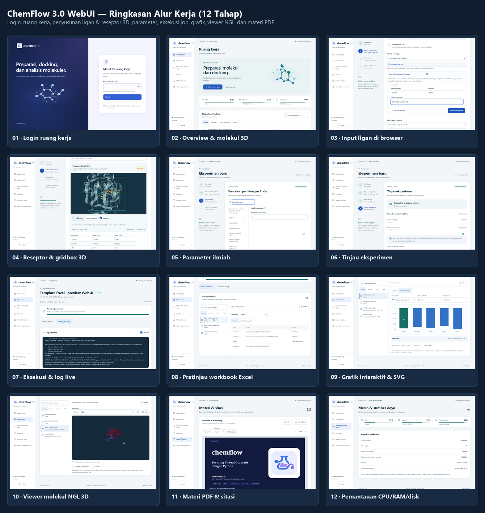

# Preview Animasi dan Urutan Demo WebUI ChemFlow 3.0

Halaman ini mendokumentasikan urutan demonstrasi pada animasi pratinjau
[`docs/assets/webui-preview.gif`](assets/webui-preview.gif) serta gambar ringkasan
statis [`docs/assets/webui-preview-poster.png`](assets/webui-preview-poster.png)
yang ditampilkan di [`README.md`](../README.md#preview-webui).



## Urutan 12 Tahap pada Rekaman

Seluruh sesi direkam langsung dari aplikasi WebUI nyata (`chemflow.web.server`)
menggunakan Chromium otomatis (Playwright) pada resolusi desktop `1360 × 900`.

| Tahap | Label pada Animasi | Fitur yang Ditampilkan |
| --- | --- | --- |
| `01` | **Login ke ruang kerja** | Halaman masuk bertema gelap-terang dengan pratinjau molekul interaktif dan autentikasi kata sandi operator (`HttpOnly`, `SameSite=Strict`). |
| `02` | **Overview, molekul interaktif dan pemantauan mesin** | Halaman utama ruang kerja, rotasi molekul hero interaktif, indikator langsung CPU/RAM/penyimpanan, dan daftar eksperimen terbaru. |
| `03` | **Wizard: pilih alur dan siapkan bahan** | Wizard 4 langkah: penamaan eksperimen dan penyusunan tabel ligan (`Aspirin`, SMILES `CC(=O)Oc1ccccc1C(=O)O`) langsung di browser tanpa perlu membuat Excel manual terlebih dahulu. |
| `04` | **Reseptor, ligan native dan gridbox 3D** | Penyusunan workbook reseptor dari kode PDB (`1HSG`), pemilihan ligan kokristal (`MK1_B902`), dan penyesuaian kotak docking (gridbox 3D) secara visual. |
| `05` | **Parameter ilmiah dan tinjauan sebelum menjalankan** | Pencarian parameter CLI/Vina (`exhaustiveness`) serta pemeriksaan ringkasan input (`ligan.xlsx`, `reseptor.xlsx`) pada langkah tinjauan. |
| `06` | **Jalankan job nyata, baca log dan unduh workbook** | Eksekusi nyata subperintah `chemflow init` melalui antrean worker WebUI, pembacaan log proses secara langsung, pratinjau isi sheet `ligan_contoh_tidy.xlsx`, dan pengunduhan berkas. |
| `07` | **Hasil: tabel, grafik interaktif dan ekspor SVG** | Pemeriksaan tabel numerik (`afinitas_demo.csv`), visualisasi grafik interaktif (batang dan garis) dengan nilai hover, serta ekspor grafik ke format vektor `.svg`. |
| `08` | **Viewer molekuler: putar dan jelajahi protein** | Penampil 3D NGL terbundel lokal untuk memutar kompleks protein-ligan (`1HSG_complex.pdb`) dan menampilkan perkiraan kontak geometrik. |
| `09` | **Workshop PDF dan sitasi di dalam WebUI** | Pembaca materi PDF (`chemflow.pdf`) terintegrasi dengan navigasi halaman serta panel sitasi metode ilmiah dan unduhan BibTeX. |
| `10` | **CPU, RAM dan penyimpanan server** | Halaman pemantauan sumber daya mesin server secara real-time (core logis, memori terpasang, kapasitas disk, dan status worker). |
| `11` | **Panduan alur kerja** | Panduan ringkas 6 langkah penggunaan WebUI mulai dari persiapan input, pemantauan checkpoint, hingga akses LAN/Cloudflare Tunnel. |
| `12` | **ChemFlow 3.0 · CLI dan WebUI dalam satu pipeline** | Kembali ke ikhtisar ruang kerja dengan histori eksperimen yang telah selesai dijalankan. |

## Catatan Data Demonstrasi

- **Isolasi penuh**: Server perekaman (`scripts/preview_web_server.py`) membuat workspace sementara di `.cache/readme-preview-*` dan hanya mendengarkan pada loopback `127.0.0.1:8766`.
- **Job nyata & fixture sintetis**: Pembuatan template Excel (`chemflow init`) benar-benar dijalankan oleh proses CLI dari browser. Tabel `afinitas_demo.csv` berisi nilai sintetis untuk mendemonstrasikan grafik interaktif, sedangkan struktur 3D menggunakan berkas uji `tests/fixtures/1HSG.pdb`.

## Cara Merekam dan Membangun Ulang Preview

Pastikan dependensi web Python dan paket frontend telah terpasang:

```sh
python -m pip install -e ".[web]"
cd frontend
npm ci
npm run build
cd ..
```

1. **Jalankan server demo lokal** (terminal pertama):

   ```sh
   python scripts/preview_web_server.py
   ```

2. **Rekam sesi browser otomatis** (terminal kedua):

   ```sh
   node scripts/record_webui_preview.mjs
   ```

   Skrip ini menghasilkan video `.cache/webui-preview/webui-preview.webm`, tangkapan layar tiap tahap (`login.png` hingga `guide.png`), dan metadata waktu `.cache/webui-preview/timeline.json`.

3. **Bangun animasi GIF dan poster statis**:

   ```sh
   python scripts/build_webui_preview.py
   ```

   Perintah di atas menghasilkan:
   - `docs/assets/webui-preview.gif` — animasi GIF dengan bilah penanda bab (chapter bar) dan indikator progres.
   - `docs/assets/webui-preview-poster.png` — gambar komposit 12 tahap untuk pembaca yang menginginkan tampilan statis.
   - `.cache/webui-preview/gif-info.json` — ringkasan ukuran berkas, jumlah frame, durasi, dan daftar unduhan yang terverifikasi.
